# Quick Launcher

**把文件、目录、软件、网址和 uTools 插件收进分组，一次呼出，一键到达。**

## 这是什么

桌面上摊着一堆快捷方式，常用目录埋在五六层文件夹里，每天开工都要重复点开同一批软件——这些"固定动作"其实每天只花你几秒钟，但一天要重复十几次。

Quick Launcher 做的事很简单：**把一组东西定义成一个分组，然后给它一个入口。**

- **分组管理**：文件 / 目录 / 软件 / 网址 / uTools 插件，甚至别的分组，都能塞进同一个分区
- **搜索直达**：给它起个名字或别名，在 uTools 搜索框里输入就能直接命中
- **一键启动**：一个分组里的东西可以全部一次性打开

## 快速开始

1. **安装**：在 uTools 插件应用市场搜索 `Quick Launcher` 安装；或本地构建后用 uTools 开发者工具加载
2. **呼出**：uTools 里输入 `ql`、`kj`、`快捷启动器` 或 `Quick Launcher`
3. **建分组**：左下角「新建分组」→ 起名、选图标、选颜色
4. **加条目**：分组里点右下角 `+`，或直接把文件拖进来

## 功能

### 桌面级入口：自定义背景 + 盒子视图

给分组配上背景图、遮罩和模糊，再用「盒子视图」铺开，呼出来就是一屏自己的桌面。

配上快捷键，搜索一键即达：

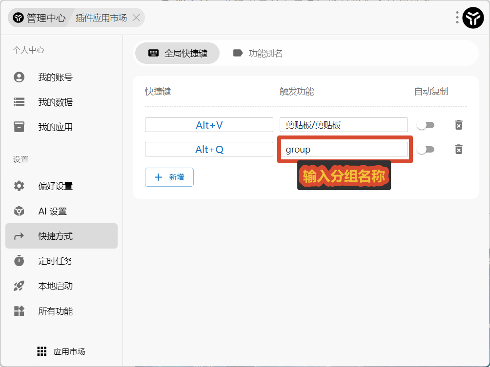

### 匹配方式与使用技巧

以「常用」分组为例，其内部包含「kjcmd」分组，

| 输入               | 含义                     | 示例                                                                  |
| :------------------- | :------------------------- | ----------------------------------------------------------------------- |
| `cy` 按 Enter      | 直接进入「常用」分组面板 |  |
| `cy 关键词`        | 在「常用」分组中搜索     | 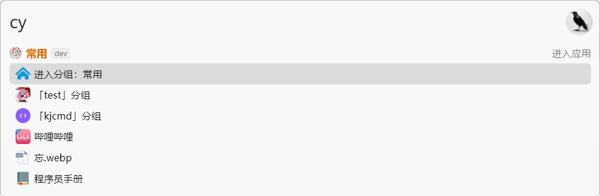 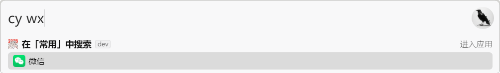 |
| `cy 子分组 关键词` | **只在该子分组里**搜索   | 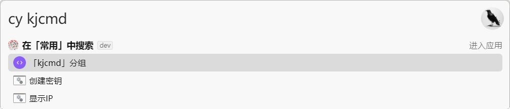 |

### 分组启用、关键词匹配、一键启动

| 开关           | 作用                                                                                                                                                                           | 介绍                                                                                                                                                                                                                                                                                                   |
| ---------------- | -------------------------------------------------------------------------------------------------------------------------------------------------------------------------------- | -------------------------------------------------------------------------------------------------------------------------------------------------------------------------------------------------------------------------------------------------------------------------------------------------------- |
| **启用** | 关闭后相当于分组不存在                                                                                                             | 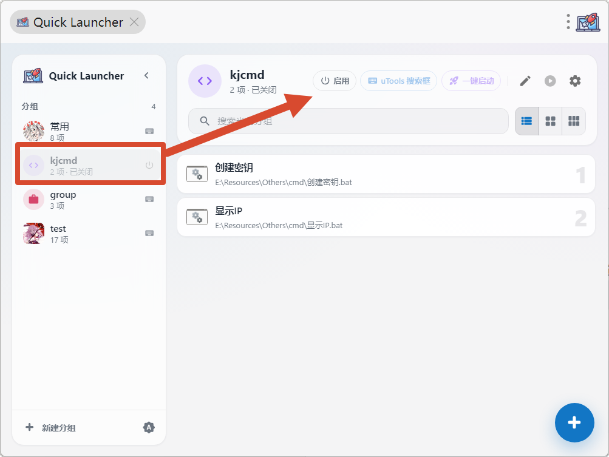                                                                                                                                                                                                                                 |
| uTools搜索框 | 允许用分组名 / 别名在 uTools 搜索里命中这个分组 | 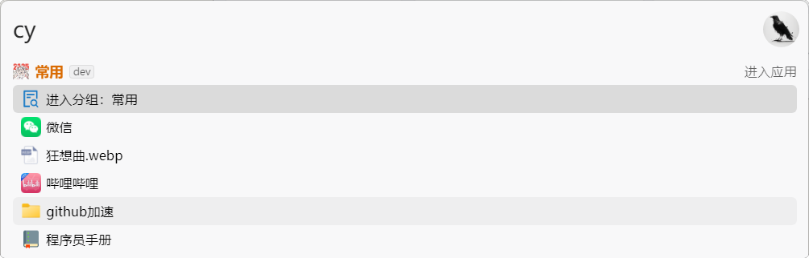 |
| **一键启动**   | 进入分组时直接启动分组内全部条目                                                                                                                                   |  |

「一键启动」与「uTools 搜索框」可以独立设置。关闭搜索框匹配后，仍可从其它分组中的入口一键启动该分组的全部文件，也可使用分组头部的运行按钮启动。

搜索 `cy kjcmd` 唯一命中开启了一键启动的「kjcmd」分组时，结果先显示「启动分组：kjcmd」，再显示「进入分组：kjcmd」，随后列出内容预览。前者打开该分组的全部文件；后者打开搜索面板，不触发一键启动。

### 多种添加方式

#### 手动添加

#### 拖动文件进入分区

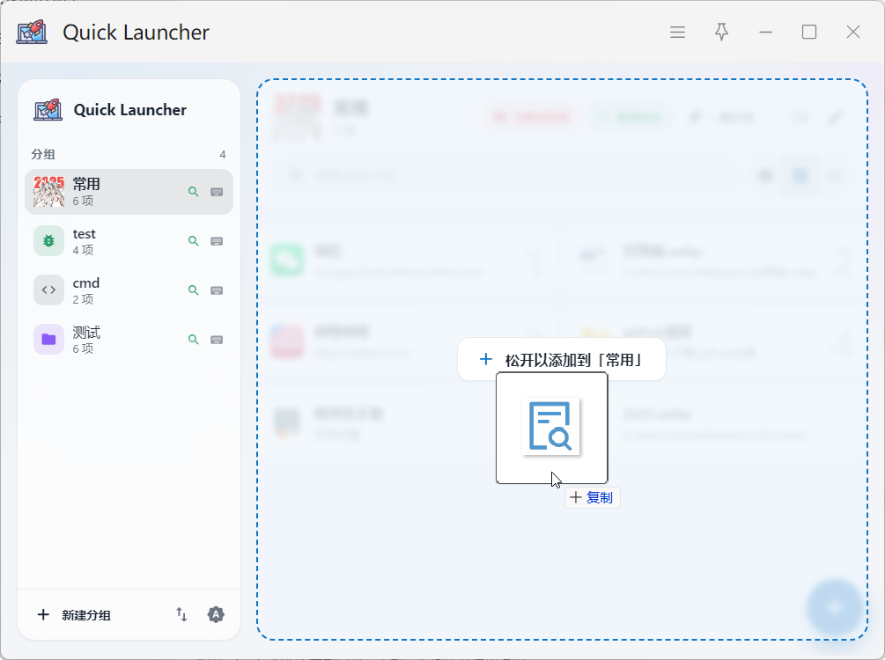

#### 选中文件添加分组

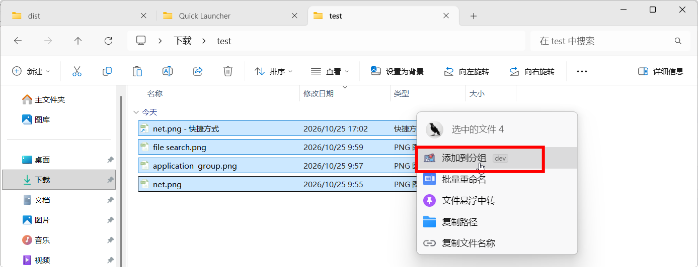

#### 复制到分组

### 其他功能

#### 自定义图标

支持内置图标【多种色彩、可调圆角】、自定义图标【更换图片、裁剪、旋转、圆角】、原生图标【仅限文件/目录/软件】、在线获取【仅限网址】

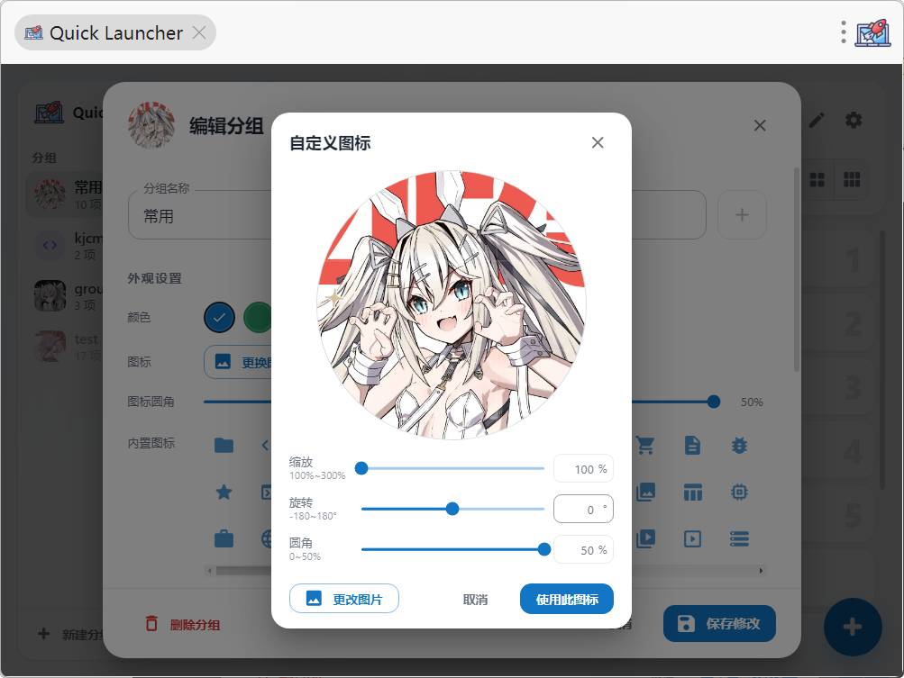

#### 项目有效性检测

#### 备份与恢复

**配置以 JSON 导出，图标和分组设置一起带上**

方法一：左侧栏空白处右键 → 导出分组…

方法二：分组设置 → 导出此分组

#### 深色主题适配

#### 解析快捷方式地址

自动解析 `link` 快捷方式文件，读取并提取它实际指向的目标地址。

因此，即使删除了快捷方式，依旧可以打开文件真实的地址。

> 更推荐的做法是把快捷方式放置到非桌面文件夹中，再导入快捷方式，而非简单的删除

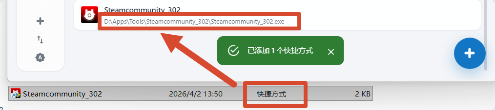

#### 多种快捷键

- `Ctrl + Enter` ：管理员身份启动
- `Alt + Enter`：打开文件所在位置
- `Alt+数字`：搜索面板打开对应项目

#### 自定义背景

**搜索外观**：字体颜色与不透明度、衬底颜色、顶栏浓度、盒子背景浓度、悬浮浓度、高亮浓度——面板右边改，左边预览实时生效

#### 支持嵌套（分组中的分组）

两种做法：从左侧栏把分组**拖进**内容区，或用 `+` 菜单里的「添加分组…」。

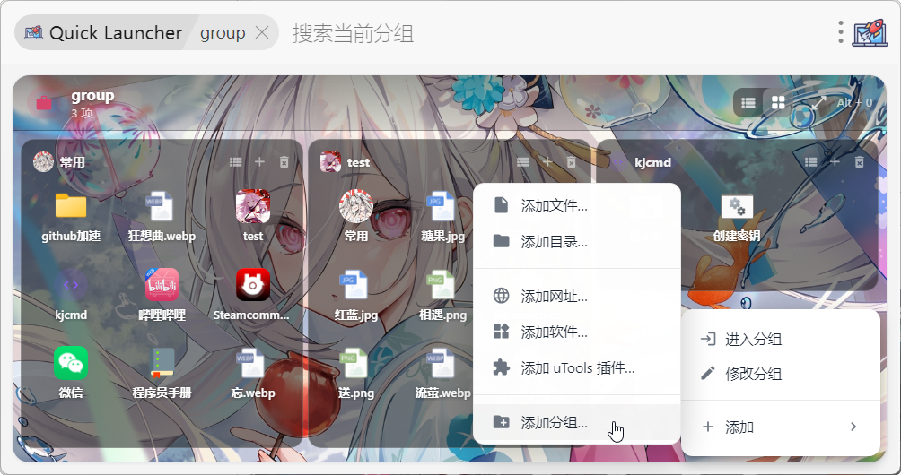

## 常见问题

**Q：开了「搜索功能」，但 uTools 搜索框里只看到磁贴，没有条目前 5 项？**
需要到 uTools 设置里开启 **运行设置 → 允许推送内容到搜索框**。

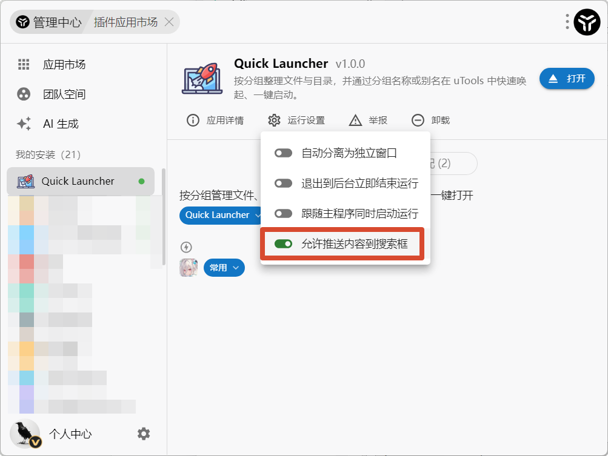

**Q：快捷方式被我删了，条目还能用吗？**
能。导入时已解析出 `.lnk` 的真实目标地址。但反过来说，如果你**移动**了目标文件，条目会失效——用「检测无效条目」把它们找出来。

**Q：数据存在哪？会上传吗？**
只存在本机（uTools 本地存储）。要换设备或备份，用「导出配置」。

**Q：网址能用指定的浏览器打开吗？**
可以。添加或修改网址时可以选择打开方式，包括系统默认浏览器、uTools 内置浏览器，以及 Chrome / Edge / Firefox 的隐私窗口等。

**Q：为什么分组里放分组没被拦住？**
只有「A 里放 A」会被阻止。`A` 和 `B` 互为入口是允许的，展开时只深入一层。

**Q：为什么分组内没有可用分组以添加？**
可能有如下的原因：分组未启用、分组已存在
