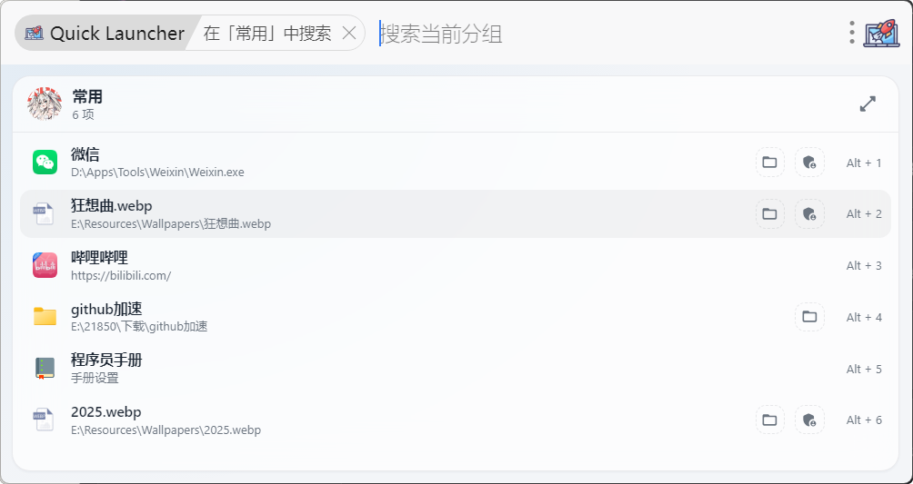
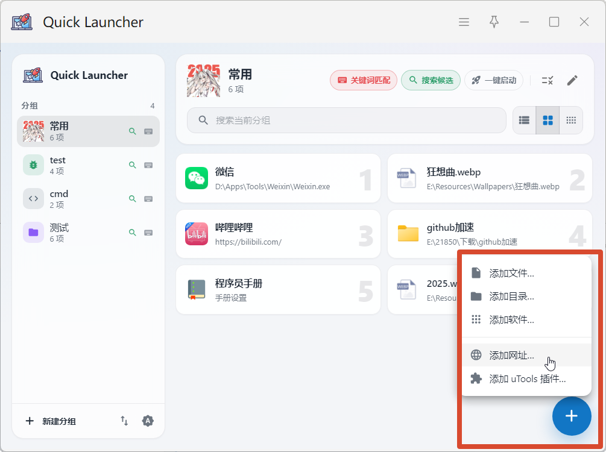
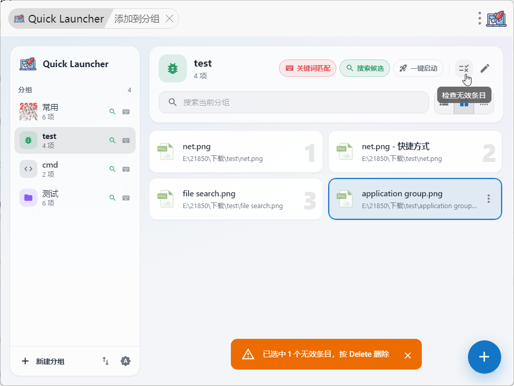

# Quick Launcher

> 一款优雅的uTools插件，专注文件的快速搜索和启动

## 添加分组：加入文件/目录/软件/网址/utools插件

## 功能

### 搜索、匹配与打开

- 开启`关键词匹配`：允许在utools搜索对应的分区名字

- 开启`搜索候选`：

  默认在搜索框上显示前五项
  
  **注意：需要开启选项「运行设置 → 允许推送内容到搜索框」**
  
  
  方法一： 输入空格后，支持在分组内搜索所有匹配的项目
  

  方法二：进入分组内容搜索
  

- 不开启`搜索候选`：
  

- 开启`一键启动`：
  打开分区内的所有文件！

### 添加方式

#### 手动添加

#### 拖动文件进入分区

#### 选中文件添加分组

#### 复制到分组

### 其他功能

#### 自定义图标

支持内置图标【多种色彩】、自定义图标【可调大小、圆角】、原生图标【原文件缩略图】、在线获取【网址】

#### 地址有效性检测

#### 导入和导出

#### 深色主题适配

#### 解析快捷方式地址

自动解析 `link` 快捷方式文件，读取并提取它实际指向的目标地址

#### 快捷键

- `Ctrl + Enter` ：管理员身份启动
- `Alt + Enter `：打开文件所在位置
